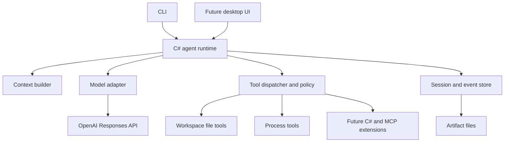

# AgentSmith: idea and implementation plan

## Model selection defaults

Schema v10 adds a single chat-default configuration row after a consistent v9 backup. It stores model/provider/endpoint/account-reference/output-budget fields separately from conversations. CLI model selection validates a detached candidate against provider discovery and current context policy, then commits the new session selection, model-change event and default in one transaction. Failed commits leave the live aggregate unchanged. Selection is idle-only and rejects unfinished runs, pending Plan review and active/reserved workers. Provider and account identity remain fixed inside a conversation.

New chats resolve explicit CLI options over the default, then fall back to the latest parent session for installations without a default. Discovery refreshes capabilities before use. Resume retains the saved session selection. Switching resets token-estimate calibration; compaction attempt identity includes the model/provider, while prior summaries and source history remain intact. Usage aggregation follows durable model-change events so historical requests and compactions keep their original model attribution. Defaults contain credential references only. The 2026-10-10 local delivery passed 452 Release tests and published executable checks with a mock catalog; live provider inference remains unverified for this change.

Cancellation persists the queue hold before signalling the runner, so a cancelled run cannot become observable before that hold. The cancellation signal is sent even if the hold write fails. This ordering correction came from the cancellation regression during delivery.

## Response repetition and compaction evidence slices

Prompt display projects ordered text/image parts independently of provider transport. Submitted-message events retain a legacy text field and add allowlisted content metadata: attachment identity, dimensions and byte count. Queue acknowledgements show image counts and labels; dispatched prompts and replay use the same renderer. Private file paths and provider image payloads are excluded. Saved history and model request preparation remain unchanged. This display follow-up is included in the 452-test local delivery; physical terminal acceptance remains unverified.

Worker result collection is also a runtime responsibility. At a refused parent completion, the coordinator waits for active children, imports settled results through the same path as `agent_result`, and saves bounded parent-facing evidence for the next inference. Full result receipts live on the parent run; original worker outcomes remain unchanged. Active workers, held reservations and uncertain effects cannot be collected as settled work. Receipt persistence precedes the worker collection marker, so restart can complete the marker without repeating imports. A failed parent save leaves the worker uncollected. New collection resets the completion-stall counter and requires another inference before final completion. Context includes bounded excerpts and artifact references as untrusted evidence, never fabricated tool calls or user instructions.

Completion checks expose a typed `CompletionRequirement` with code, reason and next action in addition to the existing boolean completion barrier. Worker coordinators identify uncollected children by number, current state and tool ID; task workflows require their saved report to be finalized. Workers that answer in prose receive instructions to submit `agent_finish` instead of failing immediately. The runner persists refused-completion feedback, refreshes it at subsequent inference boundaries and injects it as authoritative runtime state, never a fabricated user message or tool result. Terminal notices and `/status` expose the same requirement. Settling the barrier clears the feedback. Permissions, explicit decisions, worker ownership, report validation and the three-response non-progress bound remain unchanged.

The runner checks generated assistant text for runaway repetition using a bounded 32 KiB tail and five non-overlapping occurrences of a substantial 24-word phrase within the latest 1,024 words. This is a conservative pause heuristic, not a content deduplicator. Tool evidence is unchanged. Both streamed deltas and authoritative completed text are checked before admitting calls. Detection pauses with NoProgress; incomplete response items are not added to protocol history. Three consecutive tool-free responses rejected by completion barriers also pause. Steering and real tool work reset that completion counter. The renderer closes each Markdown stream at model.completed.

Compaction format 2 selects eligible historical groups and protects the latest two complete response groups. It serializes eligible material as quoted evidence, then partitions that text into bounded summary requests. These slices are not provider protocol calls: saved history and ordinary inference still retain whole call/result groups and required continuation items. Every slice carries an evidence hash and UTF-16 offsets; the snapshot records slices, the original boundary hash, model, lineage, and usage. The algorithm version is part of attempt identity.

Batch selection reserves the maximum previous summary and retry instructions. If provider token counting exceeds the estimate, the evidence slice shrinks before inference. All slices and shorter-summary retries share the eight-request limit and active run budget. Atomic activation requires complete evidence coverage, a valid summary, protected-context budget validation, and a source-boundary recheck. Interrupted requests or commits leave the previous snapshot active. Unknown capacities still use the conservative character limit.

Steering presentation uses additive `SteeringNotice` metadata: message/run/target identity, recipient label, sender provenance, delivery state and a bounded sanitized preview. The inbox retains the original text. Worker coordinators attach their known agent number to delivery events without querying storage at each inference boundary. Compact rendering groups each message's preview with its recipient, then shows short delivery updates; a bounded 512-ID display cache prevents repeated bodies. `/steering` and verbose output explicitly show previews again. No delivery-state or schema changes are introduced.

## Structured failure presentation

`FailureDetail` adds code, category, operation, target, reason, next action, and observed effect to tool results/events while preserving the legacy `error` field. Preparation rejections are distinguished from read failures and uncertain mutations. Recovery determines mutation effects; presentation does not infer rollback from an exception. Argument summaries use an allowlist of target fields and bounded credential-redacted text, never complete argument JSON or exception bodies.

Worker records persist nullable failure details, request counts/limits, and applied checkpoint counts in their existing JSON storage. Terminal events and `/agent` share these records. Missing metadata in older records remains unknown. Exact-path reservation errors identify the attempted file and bounded assignments without expanding access. SQLite failures use primary result codes, not exception-message parsing, and preserve uncertainty about unsaved effects. No schema migration or live-data backfill is required.

Automated coverage includes these changes. Current delivery evidence and remaining live-verification limits are recorded in CLI_IMPLEMENTATION_PLAN.md.

## Durable steering architecture

Implemented and published locally on 2026-10-10. Verification passed 302 core/tool and 99 CLI tests. Live Bonsai acceptance confirmed parent redirection, worker messaging, wait wakeup and explicit restart delivery; the initial restart wording failure and correction are recorded in the implementation document. ChatGPT live acceptance remains unverified.

Schema v9 adds a steering inbox after a SQLite-consistent v8 backup. Each row records root and target conversation/run identity, monotonic submission sequence, text, sender provenance, source call identity, delivery timestamps and history position. Parent and child snapshots remain independent. `ISteeringStore` is additive to the session store; inbox writes never mutate the runner's in-memory session from console callbacks.

Acceptance and ordinary completion acquire SQLite write transactions. If submission wins, completion must reconsider it; if completion wins, submission is rejected. Starting a prepared tool uses the same ordering rule. Incorporation clones the current snapshot and atomically saves skipped results for every unstarted call, the ordered steering history items and inbox transitions. Only after commit does the runner update its live snapshot. A failed commit leaves both history and inbox unchanged. Prepared but unexecuted file journals become NotApplied.

Delivery states are Pending, Incorporated, Sent and Removed. Sent is recorded on the first provider event for an ordinary inference request, not during compaction or request preparation. This is transport progress, not proof that instructions were followed. Model-issued worker messages have a unique originating root/run/call receipt; recovery returns the receipt without another send. Direct user instructions and parent-generated directions have distinct labels. Runtime permissions, workflow, reservations, deadlines and approval gates remain authoritative.

The shared wake service uses per-data-directory/run notifications plus bounded checks of persisted inbox contents. Waits return bounded output/status with `interruptedBy: steering`; only their waiting tasks stop. Process and worker lifetimes keep their existing cancellation rules. Safe-boundary checks surround tool dispatch, settled effects, response persistence, context preparation and normal completion. Started effects and incomplete provider responses retain existing recovery rules. Committed questions, review decisions and explicit finish tools take precedence; held messages remain inspectable.

Active runs retain the original prompt's history position and incorporated steering positions. Context projection preserves those entries verbatim across compaction, and memory retrieval considers the original task together with the newest direction. Pending inbox text stays outside inference until transactionally incorporated. No request/deadline budget is reset by delivery.

CLI commands, parent `agent_message`, worker runners and queue handling share this service. Ordinary busy input remains FIFO queued input; no automatic broadcasting or conversion to steering occurs. Structured `steering.*` events pass through the render coordinator, with escaped bounded previews.

Worker waits now accept 0..180,000 milliseconds (three minutes) in source. Parent guidance prefers the longer wait to reduce model polling requests. The existing task-completion/cancellation race still returns early; intermediate progress does not wake it. Process waits retain their 60-second cap. This wait-limit change is included in the refreshed Windows build; the full Release suite passed 376 tests on 2026-10-10.

## Direct web image extension

`image_read(path)` accepts public HTTP/HTTPS URLs as well as existing workspace files without changing the argument schema or replaying older calls differently. URL validation and downloads use the credential-free public-web transport. Each redirect is validated and each DNS connection is pinned to checked public addresses. The download is bounded to 10 MiB after decompression, five redirects and 30 seconds. MIME checks reject unsupported types; byte decoding still verifies PNG/JPEG/BMP with the shared dimension and normalized-size limits, including when a server omits its MIME type or uses octet-stream.

Attachment records add optional requested/final URL and retrieval timestamp fields, alongside the original-byte hash and source run/call. These fields are saved with the immutable image import, before the tool receipt. Recovery reuses that import without network access. Tool results carry a `web-image` kind and attachment reference; model-facing image projection is unchanged. Compact UI output omits URL queries. Recognized credential-bearing model arguments are removed before persistence. No additional credentials or filesystem permissions are granted, and workers use the same vision and public-network restrictions.

After the user closed the agent and authorized building, the Release suite passed all 376 tests and the self-contained Windows build was refreshed. Published help and Runtime/Tools assembly hash checks passed. Live model inspection of a remote image remains unverified; earlier live results below cover workspace images.

## Image, workspace, and HTTP tool architecture

Delivery verification: 360 Release tests passed; the self-contained Windows build and published help/resume/tool-availability smoke checks succeeded. Live Bonsai parent, worker and HTTP acceptance passed within the limitations in CLI_IMPLEMENTATION_PLAN.md. Live ChatGPT acceptance is incomplete because account/state access failed.

`image_read` imports a decoded PNG snapshot with source path/hash and originating run/call identity. Shared Windows decoding serves file tools and clipboard input. Existing attachment rows and aggregate JSON hold additive provenance fields; no new database schema is needed. Completed calls retain image IDs. The model-facing projection appends labeled image evidence after the complete response/tool-output group, without adding a new user turn to saved history. Responses and Chat Completions receive their existing image content forms. Context accounting includes projected images; compaction retains attachment references as historical evidence. Recovery reuses committed imports even when the source image has been deleted.

`workspace_map` uses managed workspace traversal with depth 1..8, 10,000 entries and 262,144 accumulated path characters as scan bounds. Defaults are depth 3 and 200 preview entries. It parses up to 32 manifests of at most 256 KiB each using XML with DTDs/entities disabled or bounded solution-text matching. Conditional declarations are not evaluated. Full bounded scans become conversation artifacts; compact overviews report omissions. Only exact image reads have the generated-folder exclusion exception.

`http_request` has method-dependent permissions and a persisted prepared effect (`ReadOnly` or `Network`). Writes require an Execute parent in Work/Document, respect approved-plan ceilings, and require settled editing workers. The task-tree lease used for process barriers excludes concurrent editing-worker admission. The runner uses the resolved effect for cancellation/recovery. Intent is saved before sending; observed results have receipts. Missing write receipts never cause automatic replay.

HTTP uses a separate client without cookies, proxies, redirects, or model credentials. DNS results must all match the destination class: loopback for localhost/literal loopback, otherwise public addresses. Socket connections use validated addresses. Requests use HTTP/1.1 and close connections; there is no application retry. Text/JSON responses become bounded artifacts. Unsupported content/encoding, truncation, interrupted bodies, and status codes remain explicit. Recognized credential rejection runs before proposed HTTP calls are persisted; response credential patterns are withheld, without claiming complete detection.

All three tools use the existing registry, workflow policy, worker filtering, terminal renderer and JSON events. Authentication profiles, LAN targets, binary downloads, OCR services, browser rendering and semantic code indexing remain deferred.

## Public web tools

`web_search` and `web_read` are Inspect-capability, read-only registry tools available in every workflow and in worker allowlists. They do not depend on a hosted model's browsing API. Search uses DuckDuckGo's HTML endpoint without an API key; read uses a dedicated credential-free `HttpClient` and AngleSharp 1.5.0 for inert HTML parsing. The model must treat sources as untrusted evidence and cite URLs. It must not transmit private project/memory contents in queries.

The transport accepts public default-port HTTP/HTTPS only, validates each redirect, resolves DNS in the connection callback, rejects non-public addresses, and connects to the vetted address. Cookies, proxies, automatic redirects, default credentials, and script/subresource loading are absent. Requests have 30-second deadlines, five redirects, 2 MiB decompressed input, bounded extraction, and sanitized errors. Search format changes or CAPTCHA produce explicit failures rather than fabricated results. Binary/PDF content and browser interaction are deferred.

Page text is retained in a `web-page` artifact with final URL, retrieval time, title, and truncation metadata. The existing artifact registry and session JSON require no schema migration. Worker reports can import these artifacts through existing collection; arbitrary cross-conversation reads remain forbidden. UI summaries show source titles/URLs and bounded excerpts. Tests were added for transport validation, extraction, artifacts, cancellation, and permissions; build/test execution and live agent acceptance await the user's build authorization.

## Pending source update: mixed GPT/local parallel workers

ChatGPT profiles already route through the provider factory using account references rather than copied credentials. The new persisted `WorkerPolicy` adds total and local admission limits. New CLI chats use six total/one local; missing policy fields default to two total/one local while explicit saved values remain unchanged. Both limits validate to 1..16. Policy lives in the existing session JSON, requiring no schema migration. Settings can change only while idle; a reduction below active counts is rejected.

The coordinator checks limits under the existing spawn/file lease in preparation and execution. Duplicate spawn receipts bypass admission checks and return the existing child. Local capacity is shared across Local and LM Studio workers, inside the total limit; local endpoint semaphores remain independent. ChatGPT inference has no local endpoint gate and can overlap across workers. Account/service limits remain external constraints, with no new transport retry or fallback. The parent is not a worker slot.

Proactive instructions prefer local profiles for routine tasks and enabled GPT profiles for difficult reasoning, implementation, and review. Each profile supports multiple independent children. Exact file reservations, serial tools within each agent, process barriers, permission ceilings, cancellation, recovery, and collection before queue dispatch remain unchanged. Worker summaries include provider identity. `agent_wait` accepts up to sixteen IDs; the sixteen-launch run ceiling and existing time/round limits remain.

This source update was initially held while a CLI agent was running; the authorized baseline build and automated regression suite passed on 2026-10-10. New regression cases cover mixed-provider capacity, race rejection, legacy persistence, duplicate spawning at capacity, cancellation, and CLI controls. GPT profile registration in the current tool environment failed before success was reported; live GPT parallelism remains unverified.

Status: the CLI supports LM Studio, model-specific workers, inspection, checkpointed edits, process execution, recovery, Plan workflow, durable task tracking, artifact access, structured .NET verification, context compaction, readable activity, Escape cancellation, and queued prompts. Live acceptance details are maintained in the CLI implementation plan. The broader architecture below remains a roadmap.

Created: 2026-10-09

Updated: 2026-10-09. LM Studio and bounded model-specific workers extend the locally published continuous-conversation foundation. The previous continuous-conversation release passed 131 tests plus live ChatGPT and native-terminal acceptance. Current worker/provider verification passed 158 automated tests and live ChatGPT/Bonsai acceptance; the self-contained Windows build has been refreshed. Measurements, model limitations, and observed outcomes are recorded in the [current delivery record](CLI_IMPLEMENTATION_PLAN.md#delivered-milestone-lm-studio-and-model-specific-subagents). The completed changes and documentation are included in the user-requested local source commit; no remote push or public publication is included.

## Clipboard, budgets, and delegation architecture (2026-10-10)

Schema v7 follows a consistent v6 backup. `UserPrompt` keeps ordered typed text/image parts. `AttachmentFiles` stores immutable PNG bytes in an owned directory with SHA-256, dimensions, size, and optional parent provenance. Attachment registration is independent of the mutable session snapshot, so the busy composer cannot overwrite runner state. Atomic queued-run creation appends the typed message and claims its queue item together. Draft/queued image IDs are excluded from inference and delegation until submitted. Resume initializes the composer callbacks before showing saved-work confirmation. That confirmation rejects attachments and gives visible paste guidance without reading the clipboard; only the subsequent chat composer accepts images. `WindowsClipboard` and image decoding remain in the CLI; `SessionModelClient` checks ownership/capability and materializes image data only for transport.

`ContextPolicy` separates advertised capacity, usable input, and the selected working budget. Local discovery uses loaded context and endpoint slots; the versioned OpenAI catalog is a sourced fallback when account metadata is absent. Balanced caps input at 128,000 tokens after output and safety reserves, triggering at 90% and targeting 60%. Unknown models keep the character fallback unless explicitly configured. Provider counting is optional; local template/tokenization includes tool definitions and labels image estimates separately. Unsupported account-route counting falls back to conservative usage-calibrated estimates. `ToolResultProjection` retains original results and registers artifacts, using bounded excerpts only for inference. Projection version and context policy participate in compaction attempt identity. Summarization stays on the parent provider, with complete protocol groups, eight requests, 32,000-token-or-smaller batches, and the existing validation/atomic activation rules.

`ExecutionPolicy` persists a 150-request/60-minute default per explicit batch. Summarization counts toward it. Structured pause reasons separate limits, failed compaction, context, and repeated non-progress. Status reports remaining requests/time; waiting tools are excluded from repetition detection. Explicit decisions and queue holds are unchanged.

Delegation is a persisted proactive/manual policy over already-enabled profiles. Workers carry purpose metadata and up to sixteen read-only grants to registered parent artifacts; granted reads do not save the parent's aggregate. Images require explicit ownership-checked sharing and child-owned provenance references. Worker admission uses the saved total/local policy (six/one in new CLI chats), with sixteen launches per root run and twenty rounds/ten minutes per worker. Endpoint-scoped capacity gates serialize local inference when only one slot is reported. Waiting is visible and measured. Sixty-second process/worker waits avoid repeated short inference polls. File reservations, permission intersections and parent verification remain authoritative. Usage separates completed local work, cached input where reported, and coordination overhead; no exact savings claim is inferred.

Release verification passed 231 tests; 39 targeted cases were rerun after the final prompt/pause adjustments. Live image sharing, reopened image queue dispatch, a 34-request task, model-aware context/compaction, delegated coding with parent-run tests, unrelated-file preservation and undo passed. Forced delegation of a tiny fixture increased cloud input; efficient task choice remains important. The Windows publish folder was refreshed. Physical Alt+V/Escape coverage and full account-route context capacity remain unverified.

See [the current delivery record](CLI_IMPLEMENTATION_PLAN.md#clipboard-input-larger-tasks-and-local-delegation) for measured acceptance and limitations. Earlier dated release records below describe their original limits.

## Current architecture: model providers and bounded workers

Compaction recovery and subfolder workspace changes, locally published 2026-10-09: summaries target 4,000 characters with the existing 8,000-character hard cap. An oversized response gets one retry from the same source evidence with a 2,000-character target; retries share the eight-request budget and reserve instruction space within the 48,000-character input cap. Incomplete responses and transport failures are not retried. No truncated summary is activated. The CLI checks failed boundaries before resuming a paused run, so `continue` cannot repeatedly emit empty run attempts; `/compact` remains the explicit retry. Interrupted oversized streams expose unavailable usage through retry events. Git commands use literal workspace pathspecs, disable rename detection in diffs, and retain helper/index-write restrictions when the repository root is an ancestor. Validation covered 194 passing automated tests across the two suites, followed by self-contained Windows publishing and published help/usage checks. Live compaction in the user's reported session remains unverified.

Token accounting is a read projection of persisted events through `SessionStore.Usage`. It reads the root and its registered child conversations in one SQLite read transaction, using each session's saved provider identity. Normal completions and successful compaction reports are counted once; the latest `Run.Usage`, worker `RequestUsage` copies, cached-token subsets and nested attribution are not added again. The CLI exposes `/usage` and `smith usage <conversation-id>`, separating local-parent usage from local-worker offload and reporting missing usage. This needs no schema migration or inference call. Local token counts do not establish counterfactual ChatGPT savings or monetary savings.

The `Local` provider adds an explicit Chat Completions transport for Bonsai 2/llama.cpp. `LocalChatModelClient` uses `/v1/models` and `/v1/chat/completions`, while the existing `LmStudio` provider retains its native discovery and Responses protocol. The provider enum appends a value without changing persisted ChatGPT/LM Studio identities; existing schema v5 records need no migration. Profile replacements affect new conversations only.

The local adapter projects stored response items into system/user/assistant/tool messages, grouping each assistant's calls before their correlated results. It buffers fragmented function names, arguments and IDs, validates the complete call set, normalizes usage, and keeps reasoning in local continuation items rather than visible answers. A successful finish reason and `[DONE]` are both required; interrupted, malformed, reasoning-only and output-limited responses cannot dispatch tools. Empty tool collections omit schemas for compaction. Account credentials never enter local requests, and unknown providers fail closed.

The Bonsai 2 endpoint update passed 176 Release tests and was published locally. The live local-only tool round trip completed in 9.3 seconds. A three-round Bonsai 2 worker applied a checkpointed file fix, which its ChatGPT parent independently verified; a read-only worker also completed. Loaded server capacity was 32,768 tokens with one inference slot; the current budget uses loaded capacity and serializes this endpoint without changing the two-worker admission ceiling. See the [endpoint acceptance record](CLI_IMPLEMENTATION_PLAN.md#bonsai-2-chat-completions-endpoint) for observed worker results and fixture limitations.

`ModelConnection` identifies ChatGPT or LM Studio, the local endpoint, output budget and loaded context metadata. The CLI model factory serves normal inference, resume, queued runs and compaction. Local inference uses flat Responses function tools and locally assembled history; provider continuation items do not cross session/provider boundaries. Reasoning is not answer text. Incomplete streams, output exhaustion and reasoning-only completion execute no proposed calls.

`WorkerProfile` snapshots describe explicitly enabled model/capability choices. `WorkerCoordinator` wraps the tool registry and creates independent child sessions through an atomic `IWorkerStore.CreateWorker` operation keyed by parent/run/call. One coordinator owns scheduling, exact file reservations, a mutation semaphore and cancellation for the tree. Worker database rows remain separate from mutable root session snapshots. SQLite v5 preserves v4 identities and state after a consistent backup.

The parent exposes `agent_spawn`, `agent_wait`, `agent_result` and `agent_cancel`; the child exposes `agent_finish`. Only listed profiles are eligible. The saved total/local concurrency policy governs active workers; sixteen may be launched in one parent run. A worker gets twenty inference rounds and ten minutes, bounded by the root deadline. Tools remain serial within each agent; requests may overlap between agents. No child process execution, nested delegation, direct questions, or plan approval is available. Curated Git inspection retains its existing constrained process implementation.

Write ownership is an exact path allowlist, with move endpoints and ancestor collisions checked. File preparation, journal persistence and effects share a critical section. No parent mutation/undo may touch reserved files, and no parent process may start while editing workers hold reservations. Editing delegation requires confirmed termination of existing conversation processes. Reservations do not isolate against external applications; stale hashes remain authoritative. Workflow/permission changes settle affected children first.

Child completion reports are evidence, never permission or automatic proof of verification. The parent collects each result before completing or dispatching queued prompts. Reports and transcripts are copied into registered parent artifacts; explicit `[artifact:ID]` references in a delegated task grant read-only paging/search access to those registered parent artifacts. Full source history remains in the originating session. Context accounting includes worker assignments, approved scope, profile choices and current worker states.

Cancellation settles children and retains completed edits. Restart reconciles journals, marks old children interrupted and never relaunches them. Ambiguous file effects keep reservations until explicit recovery/abandonment. Root-scoped `/changes` and conflict-safe `/undo` can inspect and undo child checkpoints. Agent state events are durable; UI events carry child identity, profile/model, time and separate usage without interleaving child text into the composer.

Live evidence includes two Bonsai file fixes, structured build/test verification (5/5 tests), retained reports, restart, undo, and forced CLI crash recovery with no duplicate children. Plan clarification routing, cancellation with held FIFO prompts, and local compaction were also exercised. Compaction used supplied fixture history and retained the original source hash. Earlier Bonsai patch failures and round limits remain part of the acceptance record; the parent must inspect worker changes and perform final verification.

## Previous milestone: Plan, Track, and Verify

The implementation supports ChatGPT account OAuth and a separate loopback LM Studio adapter. It includes streamed text, a serial C# model/tool loop, a capability registry, Inspect/Edit/Execute modes, checkpointed file tools, curated Git inspection, owned process sessions, durable questions, SQLite conversations, resume, cancellation, and protected Windows credentials. New conversations default to Execute; legacy conversations migrate to Inspect. See [README](README.md) for usage and verification and [CLI implementation plan](CLI_IMPLEMENTATION_PLAN.md) for delivery status.

Plan is a workflow, not a fourth permission level. It permits investigation and internal task updates but blocks workspace/process effects. A persisted Implement/Revise/Keep planning decision waits for explicit input; implementation additionally requires Edit or Execute selection. Routine progress preserves approved scope, while scope changes return to review. Schema v3 adds plans, revisions, receipts, artifacts, and verification results without changing existing permissions. .NET builds use an MSBuild logger and VSTest runs use retained TRX reports.

Plan preconditions are checked during tool preparation, before recording execution intent or stopping owned work. Execution revalidates before a plan update can change state. Submission and its receipt commit together in SQLite: recovery of a legacy started `plan_submit` uses the receipt if present, or records a noncommitted submission without replay when absent. This receipt rule does not apply to arbitrary process/file effects or to `plan_update`, which can stop processes on a scope change.

API-key access, desktop UI, extensions, and automatic publishing remain deferred; LM Studio and bounded worker delegation are implemented. Automatic compaction, readable activity, Escape cancellation, and queued follow-ups are implemented in the continuous-conversation milestone. The provider-neutral `IModelClient` remains the extension point. File-tool undo checks recorded result hashes and preserves newer work. Execute runs as the Windows user, not in an OS sandbox; its process trees die with the CLI. Checkpoints do not cover process side effects. There is no public publication or automatic commit step.

The [continuous-conversation milestone](CLI_IMPLEMENTATION_PLAN.md#delivered-milestone-readable-continuous-conversations) is the detailed delivery and acceptance specification. The [README](README.md#continuous-conversations) describes commands and current limits. The architecture additions below describe the implemented boundaries.

## 1. The idea

AgentSmith is a personal AI workbench built around our own C# agent engine. It uses OpenAI models through a supported integration to understand requests, choose tools, interpret results, and communicate with the user. Our engine owns the execution loop, context, tools, permissions, history, and recovery.

The same engine should eventually serve a command-line interface and a desktop application. A conversation can be attached to a project folder, retain useful knowledge, perform work through local tools, and leave a clear record of what happened.

The first complete workflow is software development:

> Open a project, ask the agent to investigate a problem, let it make a scoped change, run the relevant checks, inspect the diff, and resume the conversation later.

The longer-term direction is broader personal and technical work: documents, local applications, research, and repeatable workflows. Those capabilities should enter through tools and extensions rather than special cases inside the main loop.

## 2. Confirmed direction and proposed defaults

### Confirmed by the discussion

- The application is written in C#.
- We build our own agent engine.
- ChatGPT/OpenAI provides the driving model capability.
- Codex CLI and the ChatGPT desktop experience are reference points.
- This document records the architecture and future plans; delivered behavior is identified separately.

### Proposed defaults, still open to revision

- Build a working CLI before investing in the desktop interface.
- Start on Windows, keeping platform-specific execution behind interfaces.
- Use the Responses API directly; do not depend on Codex app-server or a hosted agent harness for orchestration.
- Keep conversation history and workspace state locally.
- Use SQLite for structured persistence and separate files for larger artifacts.
- Start with one agent and serial tool execution.
- Make authentication and model selection explicit rather than hard-coding one account route or model name.
- The CLI now targets .NET 10 and pins SDK 10.0.401. Select the desktop UI framework in a later milestone.

These are design proposals, not additional user requirements.

## 3. What should make it useful

### Context the user can inspect

Show the instructions, history, file excerpts, memories, and tool definitions selected for a request. Explain omissions and summarization. The user should be able to pin useful context and remove stale material.

This view describes inputs and observable actions. It does not promise access to the model's hidden reasoning.

### Work that survives a restart

Preserve messages, tool requests, results, pending questions, and task status. A restart should produce an accurate recovery state, including actions whose outcome is unknown.

Continuing a conversation and keeping a process running after the UI closes are separate features. The first version supports the former. A persistent background host can support the latter later.

### Actions with evidence

Present a file edit as a diff, a command as captured output and an exit status, and a generated artifact as an accessible file. Keep planned actions distinct from attempted, completed, and verified actions.

### Extensibility in C#

Adding a local capability should mean implementing a small tool contract. The engine supplies validation, policy checks, cancellation, event recording, and result handling. External MCP servers can later join through an adapter.

## 4. Broader coding-release scope (after the read-only foundation)

The first useful release should support:

1. Select a model connection and a workspace folder.
2. Start or resume a local conversation.
3. Stream assistant text and display tool activity.
4. List, search, and read workspace files.
5. Apply reviewable file changes with stale-file protection.
6. Execute a command with a defined working directory and captured output.
7. Ask a question and wait for an explicit response.
8. Cancel a run and report what stopped and what may still have happened.
9. Inspect changes and execution results.
10. Resume safely after application failure.

Beyond the current bounded worker milestone: nested/multi-level agent coordination, recurring tasks, voice, general desktop control, remote execution, a plugin marketplace, automatic publishing, and cloud synchronization. These remain possible extensions.

## 5. Overall architecture



The UI submits commands and consumes events. It does not implement a separate agent loop. Model-specific request and stream formats stay inside the model adapter. Tool implementations do not depend on a particular UI or OpenAI SDK type.

Initially the CLI can host the runtime in-process. If simultaneous CLI and desktop access becomes necessary, introduce a local host with authenticated IPC and one owner for each active conversation. Do not create a daemon solely to run the first prototype.

### Suggested solution layout

```text
src/
  AgentSmith.Core/               Domain records and contracts
  AgentSmith.Runtime/            Run loop, context, policy, recovery
  AgentSmith.OpenAI/             Authentication and Responses adapter
  AgentSmith.Tools/              Built-in file and process tools
  AgentSmith.Storage/            SQLite persistence and artifact storage
  AgentSmith.Cli/                Initial user interface
  AgentSmith.Desktop/            Added after the CLI workflow is sound
tests/
  AgentSmith.Tests/              State, protocol, recovery, and tool tests
  AgentSmith.IntegrationTests/   Temporary-workspace and opt-in live tests
```

Keep these boundaries practical. A small implementation may initially combine projects while preserving the direction of dependencies.

## 6. Domain model and contracts

| Concept | Responsibility |
| --- | --- |
| Workspace | Root folders, instructions, policies, and project configuration |
| Conversation | Ordered messages and durable context associated with a workspace |
| Run | Execution triggered by a user request, with status and budgets |
| Model step | One request to the model and its complete response items |
| Tool invocation | One requested action, its arguments, policy decision, and outcome |
| Question | Pending request for user input with a stable identifier |
| Artifact | File, diff, or output produced or referenced by a run |
| Memory entry | Shared durable knowledge with origin workspace, validated source, revision and user-authored protection |
| Event | Ordered observation used for persistence and UI updates |
| Context snapshot | Bounded summary and retained-history projection with source provenance; never a replacement for source history |
| Queued prompt | Durable user request awaiting one serial run, separate from answers and approval decisions |

Initial conceptual interfaces:

- `IModelClient`: stream model events for a prepared request.
- `IContextBuilder`: construct a bounded request and a context manifest.
- `ITool`: describe a capability and execute validated arguments.
- `IToolRegistry`: resolve tool names and versions.
- `IExecutionPolicy`: allow, deny, or require user input for a concrete invocation.
- `ISessionStore`: persist state transitions and retrieve conversation history.
- `IArtifactStore`: save and retrieve bounded output files.
- `ISecretStore`: retrieve credentials without exposing them in ordinary settings.

Use typed records, asynchronous APIs, and cancellation tokens. Preserve provider-specific continuation data where necessary instead of forcing every response into plain text.

## 7. The agent loop

For each user request:

1. Persist the input and create the run.
2. Load applicable instructions, permissions, recent history, and workspace state.
3. Assemble context within the selected model's supported limits.
4. Persist the context manifest and request identifier; send the model request.
5. Stream display events while assembling complete response items.
6. If the model requests tools, validate their completed arguments and resolve their implementations.
7. Evaluate execution policy outside the model.
8. Record each invocation before executing it; persist the result afterward.
9. Return the correctly associated tool results to the model.
10. Continue until the model finishes, the user interrupts, input is required, a budget is reached, or a failure prevents continuation.

Before step 4, compact eligible older context when the request reaches its trigger, using a tools-disabled model request and a transactionally saved snapshot. After a run reaches Completed and its result is persisted, dispatch the next queued prompt as a new run. Questions, reviews, cancellation, failures, paused limits, and recovery are explicit barriers; finishing a single model step does not release the queue.

OpenAI function calling supplies the request/result mechanism; AgentSmith performs the local execution and controls continuation. See [OpenAI function calling](https://developers.openai.com/api/docs/guides/function-calling).

### Rules the runtime must enforce

- Never execute incomplete streamed arguments.
- Associate every result with the original tool call identifier.
- Preserve protocol items required for subsequent requests, including opaque provider continuation data when applicable.
- Treat malformed arguments and unknown tools as structured errors; allow bounded correction.
- Do not equate transport completion with successful model or task completion.
- Enforce step, time, output, and usage limits locally where possible.
- Distinguish a finished assistant turn from independently verified task success.
- Begin with serial tools. Add parallel reads only after dependency and resource ownership rules exist.

## 8. Model integration and authentication roadmap

The current implementation supports ChatGPT account sign-in only. Direct API credentials are a future route; the following comparison remains architectural context.

| Route | Intended use | Design consequence |
| --- | --- | --- |
| Sign in with ChatGPT | Eligible use through the user's ChatGPT plan | Implement the documented OAuth flow and its route-specific requirements |
| OpenAI API credentials | Direct API access | Use an explicit API connection with its own billing and capability configuration |

The official documentation describes ChatGPT plan usage for open-source and locally hosted apps. Eligibility and consent must be verified for the intended distribution. Sign-in does not import the user's ChatGPT conversations or account context. See [Sign in with ChatGPT overview](https://developers.openai.com/siwc/token-sharing-open-source).

The current ChatGPT plan preview requires streaming requests with storage disabled and client-managed history over HTTP. It supports local function/custom tools, but several hosted tools and parameters are unavailable. AgentSmith must build requests for the chosen route rather than assume API-key and ChatGPT-plan access are interchangeable. See [preview limitations](https://developers.openai.com/siwc/token-sharing-open-source/preview-limitations).

Implementation approach:

- Prove one real authenticated request before committing to a particular login experience.
- Keep model IDs configurable and expose only compatible settings.
- Track capabilities for streaming, tools, input types, context size, and usage reporting.
- Treat a model listing as discovery; successful inference verifies access for that request.
- Use the supported C# SDK where it covers the required protocol; isolate any necessary direct HTTP code in the adapter.
- Store credentials through an OS-backed secret store, separate from session exports.
- Handle expiration, revoked access, rate limits, and interrupted streams explicitly.
- Never silently switch account routes or change the model to recover from failure.

Authentication and live inference have passed for the tested account/model route; the CLI implementation plan records the evidence. Broader account eligibility remains route-dependent. Synthetic credentials remain sufficient for deterministic tests.

## 9. Context and memory

Context assembly should be deterministic and inspectable before we add sophisticated retrieval.

Start with application instructions, the user's current request, applicable project instructions, recent conversation items, selected file excerpts, and tool results. Load project guidance according to a documented scope and precedence rule. External content is evidence, not authority to expand permissions.

Each request gets a context manifest containing source references, inclusion reasons, hashes or versions where useful, and estimated size. Preserve the actual replayable protocol history locally, with credential filtering and explicit retention controls.

The current context policy uses model capacities, output reserves and token measurements/estimates as described above. Unknown capacities retain the 120,000-character fallback with its 80% trigger and 60% target; character estimates are not model token capacity.

When compacting context:

- Keep the current request and unresolved questions intact.
- Preserve complete tool-call/result relationships.
- Bound large outputs and retain the full permitted output as an artifact.
- Summarize older material with provenance and record that summarization happened.
- Reserve room for the response and subsequent tool results.
- Show uncertainty in token estimates rather than pretending they are exact usage.

Preserve the immutable local history and construct a separate request projection containing a provenance-linked summary plus recent complete exchanges. Keep the active request, approved plan scope and permission ceiling, task state, pending questions/reviews, recovery state, and active process/artifact references. Rebuild authoritative state from storage, not from summary text. Queued prompts enter context only when dispatched. File hashes from old exchanges do not replace fresh reads before mutation.

Use ordinary model requests with tools disabled behind `IModelClient`; do not depend on an unverified hosted compaction endpoint. Bound summary inputs through protocol-complete chunks and a bounded merge. Preserve required call/result and opaque continuation groups; compact only at safe boundaries after persisted results. Record source ranges/hashes, summary lineage, model/prompt version, estimated sizes, and available usage. Treat quoted source content as evidence, not new authority. A summary cannot grant permission, approve a plan, answer a question, or turn unverified work into success.

Activate a snapshot only after durable validation and commit. Failure or cancellation retains the previous projection and all source records. If mandatory context cannot fit, pause with a recoverable explanation. Limit retries per unchanged source boundary and include compaction in active time/cancellation accounting. Do not reset step/time budgets. `/context` exposes summary provenance; `/compact` allows an idle or context-paused request without automatically resuming unfinished work. This is conversation compaction, separate from durable memory extraction.

Shared memory is separate from conversation history and is implemented through `IMemoryStore`. Schema v6 adds a library, revisions, operation receipts, FTS5 index, settings and audit events after a consistent v5 backup. The library is independent of mutable session snapshots. Writes, revisions, search-index updates and receipts share a transaction; restart recovery returns a committed receipt or records that no write committed, without replaying the operation. Revision checks serialize competing updates. User-authored changes cannot be overwritten by the model.

The parent may automatically save durable findings through normal tool calls in Work or Plan, including Inspect permission mode. `ToolEffect.MemoryState` distinguishes these writes from workspace/process effects. Workers only read/search and suggest learnings to the parent. Sources must identify user messages or completed non-memory tool calls in the same conversation; collected worker reports carry agent-conclusion attribution. The request context supplies exact recent evidence references rather than requiring the model to guess provider call identifiers.

One shared library per data directory is available across projects and providers. Retrieval uses literal FTS5 tokens from the active request or delegated task, never queued prompts. It ranks relevance before workspace/recency tie breakers. At most five full entries and 6,000 estimated characters, including provenance, enter context. Selected revisions remain fixed during compaction; the next request sees newer entries. Memory cannot approve decisions, expand permissions, authorize cross-workspace file access or replace fresh verification. Read failures warn and omit retrieval.

The user can list/search/read, add/edit, forget, or enable/disable memory through slash and standalone commands. User edits also refresh the derived title. Forgetting removes active entries and the search index; original history, revision records, receipts and backups remain. Known secret patterns and terminal controls are rejected, without claiming perfect detection. No existing conversations are bulk-processed. Embeddings, end-of-task extraction requests and background learning remain deferred; automatic saving uses the parent's existing inference and tool rounds.

Memory delivery on 2026-10-09 passed 219 automated tests and isolated live ChatGPT acceptance for saving, cross-project retrieval, worker read-only access, correction, forgetting, restart and disabling. The local Windows build was refreshed and its memory commands smoke-tested. The live worker used ChatGPT; local-provider memory inference was not separately exercised. Detailed evidence and the initial call-ID visibility fix are recorded in the CLI implementation plan.

## 10. Tool execution and workspace boundaries

Initial tools:

| Tool | Required behavior |
| --- | --- |
| List files | Bounded results, predictable ignore rules, stable paths |
| Read file | Bounded content with line information and encoding handling |
| Search text | Query, scope, and result limits recorded explicitly |
| Apply patch | Validate expected content; reject conflicting edits; produce a diff |
| Run process | Explicit executable, arguments, directory, timeout, and output limits |
| Inspect changes | Show current changes without modifying Git state |
| Ask user | Persist a question and await its explicit answer |

Resolve and validate paths against the workspace, including link and junction behavior. Recheck file versions immediately before writes. Preserve encoding and line endings where practical, and use staged writes and atomic replacement where supported. Multi-file operations need explicit partial-failure reporting; they are not automatically atomic.

Permission checks belong in the dispatcher. The model proposes actions; it cannot grant itself capabilities. Approval should refer to the concrete action and scope. Existing authorization should persist according to a visible policy rather than prompt repeatedly for identical work.

Questions requiring a user response have no automatic answer or approval timeout. Persist them across restarts. Independent work may continue only when it does not depend on that answer.

A process running under the user's account may affect resources beyond its working directory. Directory checks are not an OS sandbox. The prototype must label unrestricted shell execution accurately; stronger isolation is a separate implementation project. An investigation-only mode should not expose arbitrary shell execution as if it were read-only.

## 11. State, cancellation, and recovery

Suggested run states:

`Queued`, `Running`, `AwaitingUser`, `Paused`, `Completed`, `Failed`, `Cancelled`, and `RecoveryRequired`.

Store the reason for a pause or failure separately. Waiting on the model or a process can be activity detail within a running state. Tool invocations have their own states, including `Pending`, `Started`, `Succeeded`, `Failed`, `Cancelled`, and `OutcomeUnknown`.

### Cancellation

Propagate cancellation to requests and tools. Stop owned process trees where supported, collect final output, and report the observed result. Cancellation cannot undo changes already made or guarantee that external effects were prevented.

One input coordinator owns the composer, key events, paste mode, and pickers while runtime work continues asynchronously. Escape during active work follows Ctrl+C's cancellation path, including inference, processes, and compaction. Show cancellation progress until cleanup and persistence finish; uncertain effects remain RecoveryRequired. Escape does not exit the CLI, delete queued prompts, or discard the unsent follow-up draft. Repeated key events cannot spill into the next run.

Question/review focus takes precedence: Escape leaves that durable decision pending and never submits an answer or approval. Redirected/pasted escape characters are text, not key events; line-oriented chat can use `/cancel`. Existing picker rules and indefinite waits remain unchanged.

### Queued follow-up prompts

Accept explicit submissions during work into a bounded, durable FIFO queue. Show an acknowledgement and keep the composer available. Dispatch one prompt as a new run immediately after the preceding run's Completed result is saved; do not inject it into the in-flight model request. Turn completion remains distinct from independently verified task success.

Queue items have stable identity/order, text, submission time, state, and run linkage. Claiming an item, appending its user message to history, and creating the linked run must be one transaction under the conversation lease. An item already dispatched never becomes a new run merely because the CLI restarted. External effects retain their existing recovery guarantees and uncertainties.

Questions and plan reviews block queue dispatch and require explicitly addressed answers/decisions. Cancellation, failure, a paused limit, recovery, and restart hold queued work until explicit continuation. EOF retains submitted items but cannot submit a draft. Current workflow and permissions are checked when each item starts; queue submission cannot authorize a higher mode or approve a draft. Workflow-linked implementation runs take precedence over queued follow-ups until that workflow completes.

`/queue`, `/queue remove <id>`, `/queue clear`, and `/queue continue` manage pending requests only. Commands remain local, with a clear busy response where they require an idle state; unknown commands never reach the model. Redirected chat must distinguish addressed question/review input from queued prompts. No concurrent agent runs, live steering, process daemon, or implicit approval is added. `smith run` stays a single-request command.

### Crash recovery

Persist intent before a tool starts and its result after it finishes. A crash between the effect and the result leaves an uncertain outcome. On restart, reconcile it where possible; otherwise report it and require a deliberate recovery decision. Do not automatically retry a mutating tool just because its result is missing.

Use local identifiers to prevent duplicate dispatch within the runtime. These do not create exactly-once guarantees for arbitrary processes or external services.

### Retry behavior

Retry transient inference failures with bounded backoff when appropriate. Preserve partial responses as incomplete. Respect provider retry guidance and the run's remaining limits. Retry tools only when their semantics and observed state make repetition safe.

Budget limits stop new work; they must not automatically mark a task complete. A local spending estimate is not a guaranteed hard billing cap on an in-flight request.

## 12. Persistence and observability

Use SQLite transactions for state transitions and ordered events. Keep large outputs in an artifact directory referenced by identifiers and hashes. Add schema versions and migration tests before relying on saved sessions across releases.

Events should cover user input, run transitions, request submission, tool proposals, authorization decisions, invocation starts/results, pending questions, artifact creation, and completion. Stream text to the UI without requiring a database transaction for every token; persist response progress in bounded batches and record incomplete responses accurately.

Track duration, reported token usage, tool failures, retries, and context size. Mark estimated costs and missing usage clearly. Exclude credentials from logs and exports. Session content may still contain private workspace data, so retention and export are explicit user controls.

Conversation replay reconstructs the UI and supports debugging. It must not rerun tools. Restoring a file checkpoint is a separate action and cannot undo arbitrary external effects.

Schema v4 adds context snapshots/lineage, compaction receipts, queued prompts/run links, and stable process display aliases. Use a SQLite-consistent v3 backup and transactional migration; existing sessions start with no summaries or queued items. Compaction commit and queue claim require failure-injection tests. Add structured compaction and queue events without dropping raw activity events when normal display coalesces polls. Input, run transitions, and render events are serialized by the CLI coordinator rather than competing console readers or uncoordinated storage writes.

## 13. User interfaces

### CLI first

The CLI provides streaming conversation, tool activity, explicit questions, Ctrl+C cancellation, model selection, resume, and structured JSON events. Keep terminal formatting outside the runtime.

The display shows a friendly action plus key arguments, such as `Read src/Program.cs · lines 40–120` or `Run dotnet test · process #1`, with normal-contrast command/path text and dim metadata. Task updates show descriptions rather than bare step IDs. Stable short process aliases map to full stored IDs. Call duration, total process duration, and active response time have separate labels.

Compact display suppresses empty unchanged polls, groups logical stdout/stderr lines across chunks, and shows bounded head/tail previews with omitted counts and artifact references. It must still surface errors, truncation, exit codes, and unconfirmed termination. Preserve stream identity without promising exact cross-stream order. Commands/scripts receive bounded argument previews; omit environment values and stdin bodies, redact recognized secrets, and escape terminal controls. This presentation change alone does not shrink the model's tool results.

`/display compact|verbose` and `/details <call-id>` expose detail without flooding the transcript. The composer stays visible while work runs. One rendering owner coordinates background output and editing; the running status row updates in place, with an append-only fallback for redirected or limited terminals. JSON and durable events retain all call/result transitions even when the human transcript coalesces them. Detailed bounds and acceptance tests are in the CLI implementation plan.

Possible commands, subject to revision:

```text
smith chat --workspace <folder>
smith resume [conversation-id]
smith sessions
smith models
smith inspect <run-id>
```

The CLI's optional resume ID defaults to the most recently updated parent session in the selected data directory, regardless of the shell's current workspace. Selection reuses the existing ownership, recovery and explicit continuation flow. It does not independently resume child sessions or skip a locked latest session.

### Desktop later

The proposed layout has a project/conversation sidebar, a central conversation, and a workspace panel for files, diffs, command output, artifacts, and context inspection. The user should be able to see what is running and interrupt it without navigating away.

Choose the UI framework after deciding whether Windows integration or cross-platform delivery is the priority. Both interfaces must use the same runtime behavior and saved state.

## 14. Implementation milestones

| Phase | Deliverable | Exit criteria |
| --- | --- | --- |
| 0. Feasibility | Confirm authentication route, model protocol, and minimal project structure | A real request streams to completion; a local test function result is accepted in a follow-up request |
| 1. Engine skeleton | Domain types, run loop, events, cancellation, scripted model adapter | Deterministic tests cover normal completion, tool cycles, malformed calls, failure, and interruption |
| 2. Read-only assistant | CLI chat, context assembly, list/read/search tools, basic persistence | The agent answers a question using an unfamiliar temporary project and the conversation resumes after restart |
| 3. Editing and commands | Patch tool, process runner, policy decisions, pending questions, recovery | It changes a small project, runs checks, shows the actual diff, and avoids overwriting a concurrent edit |
| 4a. Plan, Track, and Verify (delivered) | Plan workflow, durable tasks/reviews, artifact access, structured .NET results | Recorded automated and live acceptance in the CLI implementation plan |
| 4b. Readable, Continuous Conversations (delivered) | Argument summaries, bounded activity/output, automatic compaction, Escape cancellation, durable prompt queue | Real long conversation continues after compaction; FIFO prompts run once; cancellation and review barriers survive restart |
| 4c. Further release hardening | Export, context accounting refinements, recovery hardening | Crash and disconnect tests produce accurate states and never silently repeat uncertain mutations |
| 5. Desktop client | Shared-runtime graphical interface | A saved CLI conversation opens in the desktop client with matching history and behavior |
| 6. Extensions | MCP, richer memory, optional background host and specialized tools | Each capability has an explicit permission boundary, lifecycle, and focused acceptance test |

Phases 0 and 1 can overlap through a fake model adapter if live credentials are not available. A live integration remains a release requirement, and its absence must stay visible.

The original implementation slice proved one model connection, a persisted conversation, and a harmless local tool before expanding. This milestone followed the same incremental approach: readable activity, context/persistence, cancellation input coordination, then queued dispatch and integrated acceptance.

## 15. Verification strategy

Use scripted model responses for repeatable runtime tests and a small opt-in live suite for provider compatibility. Do not use live model output as the only test oracle.

High-value scenarios include:

- Fragmented streaming arguments never cause early execution.
- Tool results retain their correct identifiers across several model steps.
- Unknown tools and invalid arguments fail visibly without executing anything.
- Denied actions stay denied even if the model requests them again.
- An unanswered question survives restart without selecting a default.
- A process exceeds its timeout or output limit without hanging the runtime.
- A file changes between read and patch, and the patch is rejected.
- A crash after a tool starts produces recovery work rather than blind repetition.
- Context reduction preserves the current request and required protocol pairs.
- Resuming or replaying history never re-executes completed tool calls.
- Compaction preserves source history, approved scope, pending decisions, required protocol groups, and observed verification; an interrupted summary never replaces working context.
- Escape cancels active work without approving a picker or discarding queued input; process cleanup is independently observed.
- Queued prompts run in FIFO order after completed turns, never become question answers, and remain held across cancellation, recovery, and restart.
- Compact rendering suppresses empty polls but retains errors, useful arguments, timing, stream identity, and access to omitted output.

The first live acceptance exercise uses a disposable C# project with a known defect. AgentSmith must inspect it, make the intended change, run meaningful checks, and report the actual result. Verify filesystem changes and process outcomes independently of the assistant's final message.

## 16. Main risks and open decisions

| Risk or decision | Current position | When to resolve |
| --- | --- | --- |
| ChatGPT plan access and distribution eligibility | Validate the documented route; keep direct API access as a distinct option | Phase 0 |
| Scope growing before the loop is dependable | Complete the coding workflow first | Throughout development |
| Windows-only or cross-platform | Windows is the proposed initial target | Before platform integrations and desktop framework selection |
| Model and SDK changes | Isolate protocol handling and use compatibility tests | Phase 0, then dependency updates |
| Arbitrary shell access | Treat it as broader trust than workspace file tools | Before enabling process execution |
| Ambiguous effects after crashes | Record uncertainty and reconcile before retrying | Before editing and commands ship |
| Context loss during long work | Preserve source history and test compaction behavior | Phase 4 |
| Memory quality and privacy | Validated provenance, protected user corrections and bounded retrieval | Shared memory release |
| Desktop framework | Undecided; CLI proves the engine first | Phase 5 |
| Open-source/public distribution and license | Not decided | Before public distribution or relying on eligibility assumptions |

## 17. Definition of success

AgentSmith is useful when a user can give it a bounded task in a real project, understand what it is doing, interrupt or answer it, inspect the resulting work, and continue later without losing the task's state.

The engine is ready to expand when these behaviors hold under failures as well as successful demonstrations. Desktop polish, more tools, and multiple agents come after that foundation.

## 18. Documentation references

OpenAI integration details were checked during the 2026-10-09 implementation. The links describe protocol requirements; separate live acceptance evidence is recorded in the CLI implementation plan. Compaction was exercised through ordinary live ChatGPT requests with tools disabled; no hosted compaction endpoint is assumed or used.

- [Function calling](https://developers.openai.com/api/docs/guides/function-calling)
- [Sign in with ChatGPT: overview](https://developers.openai.com/siwc/token-sharing-open-source)
- [Models and inference](https://developers.openai.com/siwc/token-sharing-open-source/models-and-inference)
- [ChatGPT plan usage preview limitations](https://developers.openai.com/siwc/token-sharing-open-source/preview-limitations)
- [Official SDKs](https://developers.openai.com/api/docs/libraries)


## Document and Review workflow architecture

`WorkflowMode` preserves Work=0 and Plan=1, adding Document and Review. `WorkflowPolicy` centralizes capability filtering, approved permission ceilings, and documentation file eligibility. Checks run at tool availability/preparation/execution, file preparation/application, undo, worker assignment, and CLI transition boundaries. Document exposes normal process tools only with Execute; their effects are not constrained by documentation extensions. Review allows curated Git inspection but no general process tools.

`WorkflowReport` is independent of plans and memory. It stores task/target, revisions, progress, finding IDs, source run/call references, evidence, limitations, baseline state, and a final artifact reference. Parent-only workflow tools use expected revisions and atomic session receipts. Collected child evidence can be referenced; workers cannot finalize reports. Pending decisions, uncertain mutations, active workers, and uncollected results block finalization.

The runner commits completion receipts and tool results before suppressing trailing calls and returning the parent to Work. Recovery uses the receipt to finish without re-executing effects. Plain model text cannot finish Document/Review. Context assembly includes a bounded report summary and evidence artifact IDs in ordinary budget accounting.

Review capture resolves refs through fixed Git argument arrays with helper execution disabled, retains pageable diff/status/index artifacts, and hashes readable workspace files. Evidence is bounded to 2000 files, 5000 path inventory entries, and 8 MiB characters per Git stream; bounds and read exclusions produce explicit limitations. Finalization compares a fresh capture and marks drift rather than claiming snapshot isolation. Historical comparisons remain separate from current workspace reads.

Explicit report export is a user-only operation under the task-tree mutation lock. It validates a new workspace Markdown destination and existing reservations, then uses the normal mutation journal and checkpoint path. It does not enable model writes in Review/Inspect. Schema v8 stores report records and revision rows transactionally with session state and receipts, preceded by a consistent v7 backup.

Observed delivery: 250 Release tests passed, with targeted checks repeated after final refinements. Live ChatGPT/Bonsai acceptance exercised read-only review, checkpointed documentation editing, report export, committed-progress recovery into a fresh CLI/store, compilation, and worker checkpoint undo. Source and unrelated edits were preserved. The first documentation worker exhausted its output budget without executing incomplete calls; a smaller assignment succeeded. The local Windows build includes these workflows and the green, compact terminal display. Full evidence and restart-test limits are recorded in CLI_IMPLEMENTATION_PLAN.md.
