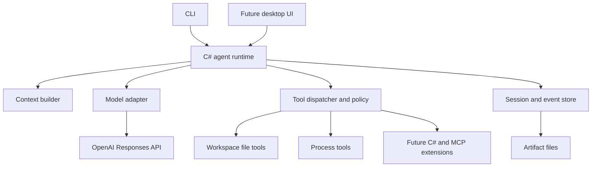

# AgentSmith: idea and implementation plan

Status: initial design draft for discussion; no application has been implemented.

Created: 2026-10-09

## 1. The idea

AgentSmith is a personal AI workbench built around our own C# agent engine. It uses OpenAI models through a supported integration to understand requests, choose tools, interpret results, and communicate with the user. Our engine owns the execution loop, context, tools, permissions, history, and recovery.

The same engine should eventually serve a command-line interface and a desktop application. A conversation can be attached to a project folder, retain useful knowledge, perform work through local tools, and leave a clear record of what happened.

The first complete workflow is software development:

> Open a project, ask the agent to investigate a problem, let it make a scoped change, run the relevant checks, inspect the diff, and resume the conversation later.

The longer-term direction is broader personal and technical work: documents, local applications, research, and repeatable workflows. Those capabilities should enter through tools and extensions rather than special cases inside the main loop.

## 2. Confirmed direction and proposed defaults

### Confirmed by the discussion

- The application is written in C#.
- We build our own agent engine.
- ChatGPT/OpenAI provides the driving model capability.
- Codex CLI and the ChatGPT desktop experience are reference points.
- This document develops the idea and plan before implementation.

### Proposed defaults, still open to revision

- Build a working CLI before investing in the desktop interface.
- Start on Windows, keeping platform-specific execution behind interfaces.
- Use the Responses API directly; do not depend on Codex app-server or a hosted agent harness for orchestration.
- Keep conversation history and workspace state locally.
- Use SQLite for structured persistence and separate files for larger artifacts.
- Start with one agent and serial tool execution.
- Make authentication and model selection explicit rather than hard-coding one account route or model name.
- Select the .NET version and UI framework at the implementation milestone after checking their current support and project needs.

These are design proposals, not additional user requirements.

## 3. What should make it useful

### Context the user can inspect

Show the instructions, history, file excerpts, memories, and tool definitions selected for a request. Explain omissions and summarization. The user should be able to pin useful context and remove stale material.

This view describes inputs and observable actions. It does not promise access to the model's hidden reasoning.

### Work that survives a restart

Preserve messages, tool requests, results, pending questions, and task status. A restart should produce an accurate recovery state, including actions whose outcome is unknown.

Continuing a conversation and keeping a process running after the UI closes are separate features. The first version supports the former. A persistent background host can support the latter later.

### Actions with evidence

Present a file edit as a diff, a command as captured output and an exit status, and a generated artifact as an accessible file. Keep planned actions distinct from attempted, completed, and verified actions.

### Extensibility in C#

Adding a local capability should mean implementing a small tool contract. The engine supplies validation, policy checks, cancellation, event recording, and result handling. External MCP servers can later join through an adapter.

## 4. First release scope

The first useful release should support:

1. Select a model connection and a workspace folder.
2. Start or resume a local conversation.
3. Stream assistant text and display tool activity.
4. List, search, and read workspace files.
5. Apply reviewable file changes with stale-file protection.
6. Execute a command with a defined working directory and captured output.
7. Ask a question and wait for an explicit response.
8. Cancel a run and report what stopped and what may still have happened.
9. Inspect changes and execution results.
10. Resume safely after application failure.

Out of scope for the first release: multi-agent coordination, recurring tasks, voice, general desktop control, remote execution, a plugin marketplace, automatic publishing, and cloud synchronization. These remain possible extensions.

## 5. Overall architecture



The UI submits commands and consumes events. It does not implement a separate agent loop. Model-specific request and stream formats stay inside the model adapter. Tool implementations do not depend on a particular UI or OpenAI SDK type.

Initially the CLI can host the runtime in-process. If simultaneous CLI and desktop access becomes necessary, introduce a local host with authenticated IPC and one owner for each active conversation. Do not create a daemon solely to run the first prototype.

### Suggested solution layout

```text
src/
  AgentSmith.Core/               Domain records and contracts
  AgentSmith.Runtime/            Run loop, context, policy, recovery
  AgentSmith.OpenAI/             Authentication and Responses adapter
  AgentSmith.Tools/              Built-in file and process tools
  AgentSmith.Storage/            SQLite persistence and artifact storage
  AgentSmith.Cli/                Initial user interface
  AgentSmith.Desktop/            Added after the CLI workflow is sound
tests/
  AgentSmith.Tests/              State, protocol, recovery, and tool tests
  AgentSmith.IntegrationTests/   Temporary-workspace and opt-in live tests
```

Keep these boundaries practical. A small implementation may initially combine projects while preserving the direction of dependencies.

## 6. Domain model and contracts

| Concept | Responsibility |
| --- | --- |
| Workspace | Root folders, instructions, policies, and project configuration |
| Conversation | Ordered messages and durable context associated with a workspace |
| Run | Execution triggered by a user request, with status and budgets |
| Model step | One request to the model and its complete response items |
| Tool invocation | One requested action, its arguments, policy decision, and outcome |
| Question | Pending request for user input with a stable identifier |
| Artifact | File, diff, or output produced or referenced by a run |
| Memory entry | Durable knowledge with scope, source, and review state |
| Event | Ordered observation used for persistence and UI updates |

Initial conceptual interfaces:

- `IModelClient`: stream model events for a prepared request.
- `IContextBuilder`: construct a bounded request and a context manifest.
- `ITool`: describe a capability and execute validated arguments.
- `IToolRegistry`: resolve tool names and versions.
- `IExecutionPolicy`: allow, deny, or require user input for a concrete invocation.
- `ISessionStore`: persist state transitions and retrieve conversation history.
- `IArtifactStore`: save and retrieve bounded output files.
- `ISecretStore`: retrieve credentials without exposing them in ordinary settings.

Use typed records, asynchronous APIs, and cancellation tokens. Preserve provider-specific continuation data where necessary instead of forcing every response into plain text.

## 7. The agent loop

For each user request:

1. Persist the input and create the run.
2. Load applicable instructions, permissions, recent history, and workspace state.
3. Assemble context within the selected model's supported limits.
4. Persist the context manifest and request identifier; send the model request.
5. Stream display events while assembling complete response items.
6. If the model requests tools, validate their completed arguments and resolve their implementations.
7. Evaluate execution policy outside the model.
8. Record each invocation before executing it; persist the result afterward.
9. Return the correctly associated tool results to the model.
10. Continue until the model finishes, the user interrupts, input is required, a budget is reached, or a failure prevents continuation.

OpenAI function calling supplies the request/result mechanism; AgentSmith performs the local execution and controls continuation. See [OpenAI function calling](https://developers.openai.com/api/docs/guides/function-calling).

### Rules the runtime must enforce

- Never execute incomplete streamed arguments.
- Associate every result with the original tool call identifier.
- Preserve protocol items required for subsequent requests, including opaque provider continuation data when applicable.
- Treat malformed arguments and unknown tools as structured errors; allow bounded correction.
- Do not equate transport completion with successful model or task completion.
- Enforce step, time, output, and usage limits locally where possible.
- Distinguish a finished assistant turn from independently verified task success.
- Begin with serial tools. Add parallel reads only after dependency and resource ownership rules exist.

## 8. Model integration and authentication

“ChatGPT-powered” has two possible account routes. The runtime should share a model adapter while preserving the differences in authentication and available features.

| Route | Intended use | Design consequence |
| --- | --- | --- |
| Sign in with ChatGPT | Eligible use through the user's ChatGPT plan | Implement the documented OAuth flow and its route-specific requirements |
| OpenAI API credentials | Direct API access | Use an explicit API connection with its own billing and capability configuration |

The official documentation describes ChatGPT plan usage for open-source and locally hosted apps. Eligibility and consent must be verified for the intended distribution. Sign-in does not import the user's ChatGPT conversations or account context. See [Sign in with ChatGPT overview](https://developers.openai.com/siwc/token-sharing-open-source).

The current ChatGPT plan preview requires streaming requests with storage disabled and client-managed history over HTTP. It supports local function/custom tools, but several hosted tools and parameters are unavailable. AgentSmith must build requests for the chosen route rather than assume API-key and ChatGPT-plan access are interchangeable. See [preview limitations](https://developers.openai.com/siwc/token-sharing-open-source/preview-limitations).

Implementation approach:

- Prove one real authenticated request before committing to a particular login experience.
- Keep model IDs configurable and expose only compatible settings.
- Track capabilities for streaming, tools, input types, context size, and usage reporting.
- Treat a model listing as discovery; successful inference verifies access for that request.
- Use the supported C# SDK where it covers the required protocol; isolate any necessary direct HTTP code in the adapter.
- Store credentials through an OS-backed secret store, separate from session exports.
- Handle expiration, revoked access, rate limits, and interrupted streams explicitly.
- Never silently switch account routes or change the model to recover from failure.

Authentication availability is an early feasibility check, not a capability already demonstrated in this project. No credentials are needed to develop this document or the deterministic test harness.

## 9. Context and memory

Context assembly should be deterministic and inspectable before we add sophisticated retrieval.

Start with application instructions, the user's current request, applicable project instructions, recent conversation items, selected file excerpts, and tool results. Load project guidance according to a documented scope and precedence rule. External content is evidence, not authority to expand permissions.

Each request gets a context manifest containing source references, inclusion reasons, hashes or versions where useful, and estimated size. Preserve the actual replayable protocol history locally, with credential filtering and explicit retention controls.

When context becomes too large:

- Keep the current request and unresolved questions intact.
- Preserve complete tool-call/result relationships.
- Bound large outputs and retain the full permitted output as an artifact.
- Summarize older material with provenance and record that summarization happened.
- Reserve room for the response and subsequent tool results.
- Show uncertainty in token estimates rather than pretending they are exact usage.

Memory is separate from conversation history. Begin with explicit project notes. Later entries can record preferences, decisions, and stable facts with their source, scope, timestamp, and review status. Model-generated suggestions should not silently become authoritative memory. Users can inspect, edit, and delete entries.

Embeddings and automatic memory extraction are later optimizations, justified by retrieval quality rather than added by default.

## 10. Tool execution and workspace boundaries

Initial tools:

| Tool | Required behavior |
| --- | --- |
| List files | Bounded results, predictable ignore rules, stable paths |
| Read file | Bounded content with line information and encoding handling |
| Search text | Query, scope, and result limits recorded explicitly |
| Apply patch | Validate expected content; reject conflicting edits; produce a diff |
| Run process | Explicit executable, arguments, directory, timeout, and output limits |
| Inspect changes | Show current changes without modifying Git state |
| Ask user | Persist a question and await its explicit answer |

Resolve and validate paths against the workspace, including link and junction behavior. Recheck file versions immediately before writes. Preserve encoding and line endings where practical, and use staged writes and atomic replacement where supported. Multi-file operations need explicit partial-failure reporting; they are not automatically atomic.

Permission checks belong in the dispatcher. The model proposes actions; it cannot grant itself capabilities. Approval should refer to the concrete action and scope. Existing authorization should persist according to a visible policy rather than prompt repeatedly for identical work.

Questions requiring a user response have no automatic answer or approval timeout. Persist them across restarts. Independent work may continue only when it does not depend on that answer.

A process running under the user's account may affect resources beyond its working directory. Directory checks are not an OS sandbox. The prototype must label unrestricted shell execution accurately; stronger isolation is a separate implementation project. An investigation-only mode should not expose arbitrary shell execution as if it were read-only.

## 11. State, cancellation, and recovery

Suggested run states:

`Queued`, `Running`, `AwaitingUser`, `Paused`, `Completed`, `Failed`, `Cancelled`, and `RecoveryRequired`.

Store the reason for a pause or failure separately. Waiting on the model or a process can be activity detail within a running state. Tool invocations have their own states, including `Pending`, `Started`, `Succeeded`, `Failed`, `Cancelled`, and `OutcomeUnknown`.

### Cancellation

Propagate cancellation to requests and tools. Stop owned process trees where supported, collect final output, and report the observed result. Cancellation cannot undo changes already made or guarantee that external effects were prevented.

### Crash recovery

Persist intent before a tool starts and its result after it finishes. A crash between the effect and the result leaves an uncertain outcome. On restart, reconcile it where possible; otherwise report it and require a deliberate recovery decision. Do not automatically retry a mutating tool just because its result is missing.

Use local identifiers to prevent duplicate dispatch within the runtime. These do not create exactly-once guarantees for arbitrary processes or external services.

### Retry behavior

Retry transient inference failures with bounded backoff when appropriate. Preserve partial responses as incomplete. Respect provider retry guidance and the run's remaining limits. Retry tools only when their semantics and observed state make repetition safe.

Budget limits stop new work; they must not automatically mark a task complete. A local spending estimate is not a guaranteed hard billing cap on an in-flight request.

## 12. Persistence and observability

Use SQLite transactions for state transitions and ordered events. Keep large outputs in an artifact directory referenced by identifiers and hashes. Add schema versions and migration tests before relying on saved sessions across releases.

Events should cover user input, run transitions, request submission, tool proposals, authorization decisions, invocation starts/results, pending questions, artifact creation, and completion. Stream text to the UI without requiring a database transaction for every token; persist response progress in bounded batches and record incomplete responses accurately.

Track duration, reported token usage, tool failures, retries, and context size. Mark estimated costs and missing usage clearly. Exclude credentials from logs and exports. Session content may still contain private workspace data, so retention and export are explicit user controls.

Conversation replay reconstructs the UI and supports debugging. It must not rerun tools. Restoring a file checkpoint is a separate action and cannot undo arbitrary external effects.

## 13. User interfaces

### CLI first

Provide streaming conversation, readable tool activity, explicit questions, cancellation, model selection, and conversation resume. Keep terminal formatting outside the runtime. A later machine-readable output mode can expose the same event stream.

Possible commands, subject to revision:

```text
smith chat --workspace <folder>
smith resume <conversation-id>
smith sessions
smith models
smith inspect <run-id>
```

### Desktop later

The proposed layout has a project/conversation sidebar, a central conversation, and a workspace panel for files, diffs, command output, artifacts, and context inspection. The user should be able to see what is running and interrupt it without navigating away.

Choose the UI framework after deciding whether Windows integration or cross-platform delivery is the priority. Both interfaces must use the same runtime behavior and saved state.

## 14. Implementation milestones

| Phase | Deliverable | Exit criteria |
| --- | --- | --- |
| 0. Feasibility | Confirm authentication route, model protocol, and minimal project structure | A real request streams to completion; a local test function result is accepted in a follow-up request |
| 1. Engine skeleton | Domain types, run loop, events, cancellation, scripted model adapter | Deterministic tests cover normal completion, tool cycles, malformed calls, failure, and interruption |
| 2. Read-only assistant | CLI chat, context assembly, list/read/search tools, basic persistence | The agent answers a question using an unfamiliar temporary project and the conversation resumes after restart |
| 3. Editing and commands | Patch tool, process runner, policy decisions, pending questions, recovery | It changes a small project, runs checks, shows the actual diff, and avoids overwriting a concurrent edit |
| 4. Dependable local release | Context limits, compaction, usage display, export, recovery hardening | Crash and disconnect tests produce accurate states and never silently repeat uncertain mutations |
| 5. Desktop client | Shared-runtime graphical interface | A saved CLI conversation opens in the desktop client with matching history and behavior |
| 6. Extensions | MCP, richer memory, optional background host and specialized tools | Each capability has an explicit permission boundary, lifecycle, and focused acceptance test |

Phases 0 and 1 can overlap through a fake model adapter if live credentials are not available. A live integration remains a release requirement, and its absence must stay visible.

The first implementation slice should be deliberately small: one model connection, one conversation, one harmless local tool, one persisted run, and an end-to-end test. Expand only after that full path works.

## 15. Verification strategy

Use scripted model responses for repeatable runtime tests and a small opt-in live suite for provider compatibility. Do not use live model output as the only test oracle.

High-value scenarios include:

- Fragmented streaming arguments never cause early execution.
- Tool results retain their correct identifiers across several model steps.
- Unknown tools and invalid arguments fail visibly without executing anything.
- Denied actions stay denied even if the model requests them again.
- An unanswered question survives restart without selecting a default.
- A process exceeds its timeout or output limit without hanging the runtime.
- A file changes between read and patch, and the patch is rejected.
- A crash after a tool starts produces recovery work rather than blind repetition.
- Context reduction preserves the current request and required protocol pairs.
- Resuming or replaying history never re-executes completed tool calls.

The first live acceptance exercise uses a disposable C# project with a known defect. AgentSmith must inspect it, make the intended change, run meaningful checks, and report the actual result. Verify filesystem changes and process outcomes independently of the assistant's final message.

## 16. Main risks and open decisions

| Risk or decision | Current position | When to resolve |
| --- | --- | --- |
| ChatGPT plan access and distribution eligibility | Validate the documented route; keep direct API access as a distinct option | Phase 0 |
| Scope growing before the loop is dependable | Complete the coding workflow first | Throughout development |
| Windows-only or cross-platform | Windows is the proposed initial target | Before platform integrations and desktop framework selection |
| Model and SDK changes | Isolate protocol handling and use compatibility tests | Phase 0, then dependency updates |
| Arbitrary shell access | Treat it as broader trust than workspace file tools | Before enabling process execution |
| Ambiguous effects after crashes | Record uncertainty and reconcile before retrying | Before editing and commands ship |
| Context loss during long work | Preserve source history and test compaction behavior | Phase 4 |
| Memory quality and privacy | Start with explicit notes and inspectable provenance | Before automatic memory features |
| Desktop framework | Undecided; CLI proves the engine first | Phase 5 |
| Open-source/public distribution and license | Not decided | Before public distribution or relying on eligibility assumptions |

## 17. Definition of success

AgentSmith is useful when a user can give it a bounded task in a real project, understand what it is doing, interrupt or answer it, inspect the resulting work, and continue later without losing the task's state.

The engine is ready to expand when these behaviors hold under failures as well as successful demonstrations. Desktop polish, more tools, and multiple agents come after that foundation.

## 18. Documentation references

OpenAI integration details were checked on 2026-10-09. Recheck availability and request requirements during Phase 0; the links establish documented behavior, not a successful integration in this repository.

- [Function calling](https://developers.openai.com/api/docs/guides/function-calling)
- [Sign in with ChatGPT: overview](https://developers.openai.com/siwc/token-sharing-open-source)
- [Models and inference](https://developers.openai.com/siwc/token-sharing-open-source/models-and-inference)
- [ChatGPT plan usage preview limitations](https://developers.openai.com/siwc/token-sharing-open-source/preview-limitations)
- [Official SDKs](https://developers.openai.com/api/docs/libraries)
